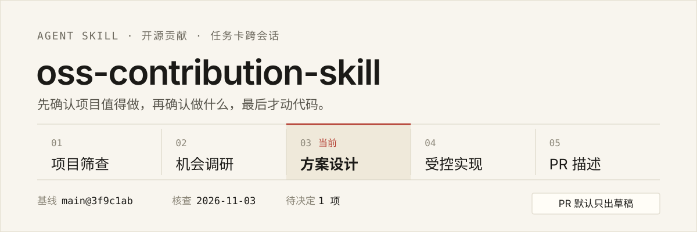

# oss-contribution-skill

<p align="center">
  
</p>

让 Agent 按成熟的开源协作节奏推进一次贡献：先判断项目值不值得投入，再定位机会、设计最小改动、受控实现，最后提交 PR。全过程记在一张本地任务卡上，跨会话不丢上下文。

## 安装

```bash
git clone https://github.com/chake111/oss-contribution-skill.git ~/.codex/skills/oss-contribution
```

目录名必须是 `oss-contribution`，与 `SKILL.md` 的 `name` 字段一致，否则 Agent 不会加载。其他环境换成对应的 skills 目录即可，例如 WorkBuddy 是 `~/.workbuddy/skills/oss-contribution`。

装好后直接说需求，不需要记命令：

- `帮我找一个适合首次贡献的 AI Agent 项目`
- `https://github.com/owner/repo 这个仓库，有什么值得做的`
- `接着上次的任务卡继续`

想确认有没有装好：让它读一遍 `SKILL.md` 并复述五个阶段，能说对就是加载成功。

## 输出长什么样

下面是格式示意（占位数据，数字只表示格式）；实际输出会带核查日期、分支、SHA 和原始链接。

筛查结论：

| 检查项 | 实测 | 判断 |
|---|---|---|
| 最近一次提交 | 3 天前，涉及 4 个文件 | 通过 |
| Issue 关闭率 | 312 / 96 ≈ 3.2 | 通过 |
| 近 10 个 PR 响应 | 中位数 4 天 | 通过 |
| 许可证与协议 | Apache-2.0，需签 DCO | 需注意 |
| 本地测试环境 | 需 Docker，约 8GB 内存 | 成本中等 |

任务卡片段：

```text
当前阶段：方案设计
下一步：把 A 方案的接口改法贴到 Issue #482，按自检清单发布
自主决策记录：是否顺带修同文件里的空指针 → 不做，留给后续 PR

基线：main @ 3f9c1ab，核查于 2026-11-03
已验证：pnpm test 失败 2 例，与 Issue 描述一致
源码推断：src/queue/worker.ts:142 在 drain 时直接清空内存队列
```

PR 正文（节选）：

```text
fix(queue): 避免 worker 重启时丢弃未提交的任务

Problem
重启时 queue 在 drain 阶段直接清空内存队列，未提交的任务不会重新入队。

Testing
pnpm test queue -- --grep "restart"    修复前失败 2 例，修复后通过
```

## 它解决什么问题

用 AI 做开源贡献，卡点通常不是写不出代码：

- **选错项目**：没看维护状态就投入，最后沉在无人审阅的仓库里。
- **PR 被直接关闭**：跳过沟通，或顺手改了无关文件的格式。
- **描述变成负担**：长篇模板套话，反而增加维护者的审阅成本。
- **上下文丢失**：Issue、Review、CI 来回往往跨越多天，一次会话结束就得从头梳理。

这套流程约束的是节奏：先确认值得做，再确认做什么，最后才动代码。

## 五个阶段

默认按顺序推进，也可以从中间切入——手上已有 Issue，就直接进第二阶段。

| 阶段 | 你手头有什么 | 产出 | 参考 |
|---|---|---|---|
| 1 项目筛查 | 只有领域方向 | 满足健康度指标的项目清单及证据 | [screen.md](references/screen.md) |
| 2 机会调研 | 一个仓库或 Issue | 候选方向若干，自选一个并说明依据 | [research.md](references/research.md) |
| 3 方案设计 | 选定方向 | 方案对比、工作量估算、维护者评论 | [design.md](references/design.md) |
| 4 受控实现 | 方案定稿 | 最小 diff、本地构建与测试结果 | [implement.md](references/implement.md) |
| 5 PR 描述 | 已有改动 | 对齐仓库模板的标题与正文，自检后创建 PR | [pr.md](references/pr.md) |

三条贯穿全程的硬约束：

- 记录日期、分支、SHA 和原始链接；实测、源码推断、待核实分开写。
- 评论和 PR 发布前走一份自检清单，通过就发；要留草稿就在卡片写 `publish: dry-run`。
- 实现阶段只改方案内的代码，不引入新依赖，不重构周边逻辑。

## 自主运行

流程里没有人工确认节点。方向、方案、接口、范围、措辞都由 Agent 自己定，每个决定在任务卡留“决定—依据—放弃的选项”，然后继续往下走，不停下来等人回复。

发布评论和 PR 前逐条自检：Issue 未被认领、无同问题的进行中 PR、本地测试通过、diff 与描述逐条对应、语言与仓库一致、不含敏感信息。全部通过即发布，链接与时间写回任务卡。

自主不等于放开范围：最小改动、范围边界、测试要求仍然约束输出，只是把“问不问人”换成了“写不写清依据”。

## 跨会话：任务卡与叙事文档

选定方向后建一张任务卡（模板见 [assets/task-card.md](assets/task-card.md)）。**卡片放在项目工作树之外**，否则会污染 diff。

卡片记四类信息：基本信息（仓库、Issue/PR、分支）、当前阶段与下一步、关键上下文（设计约束、核心文件、验证命令）、变更与决策记录。

每次推进时更新卡片；接续时先读卡，再重新核对可能变化的 Issue 状态、认领情况和代码版本——上次的结论不能直接沿用。

### 面试叙事

同一目录下另建一份叙事文档，覆盖背景、贡献、过程、成果、困难、复盘、核心能力七部分。

关键约束是别把计划说成结果：设计阶段只写「我已核实」「我比较过」「我计划」，实现、测试、评审拿到证据后再回填；转述来的内容标注来源，不写成亲自实测。

## 限制

- 面向**单 PR 规模**的贡献。大型特性、长期维护者角色不在范围内。
- 默认预算两周内完成实现、测试并提交 PR。时间更紧时应缩小改动范围，而不是压缩验证。
- 目标仓库需要有可运行的测试或本地环境，否则第四阶段无法闭环。
- 需要 Agent 支持 Agent Skills 格式（`SKILL.md` + `references/` 目录约定）。文档目前只有中文，向英文仓库提交时 PR 正文要按仓库语言重写。

## 许可证

MIT，见 [LICENSE](LICENSE)。改动比建议更有用，但提 PR 前请先开 Issue 说明意图——这条规则对本仓库同样适用。
